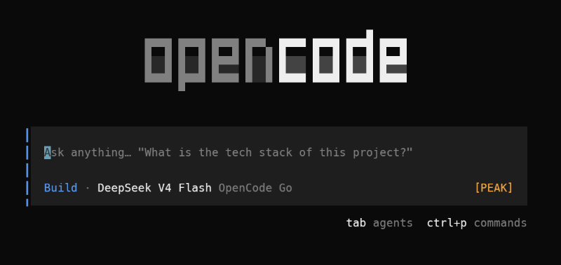

# opencode-peak-badge

[](https://go.hugobatista.com/gh/opencode-peak-badge/releases)
[](https://go.hugobatista.com/gh/opencode-peak-badge/actions/workflows/lint.yml)
[](https://go.hugobatista.com/gh/opencode-peak-badge/actions/workflows/test.yml)
[](https://www.npmjs.com/package/opencode-peak-badge)

OpenCode plugin for the TUI and OpenCode Desktop. In the TUI it shows a
`[PEAK]` / `[OFF-PEAK]` badge in the footer status line. In Desktop it shows a
chip in the session header and a status strip on Home. When a subagent
session is running, its model is tracked too: peak wins across the main model
and all running subagents. Updates live — no restart needed when a session
crosses a peak window boundary.



> **Using OpenCode V1 (CLI v1)?** OpenCode V2 changed the plugin API, so this
> plugin was rewritten. `0.3.0` is the last release compatible with V1. Since
> `0.4.0` the npm `latest` tag points at the V2 build, so **pin the version**:
> use `opencode-peak-badge@opencode-v1` (or `@0.3.0`). See
> [OpenCode V1 (legacy)](#opencode-v1-legacy).

## What it does

- TUI: renders a badge in the footer status line via `prompt.footer.status`
  (session) and `home.footer.status` (home) whenever a model with configured peak
  hours is active — or always, with `alwaysShow: true`.
- Desktop: renders a chip in the session header, next to the context
  indicator, and a `window.bottom` strip on Home, using the same rules and
  labels.
- `[PEAK]` renders in the theme's warning color. `[OFF-PEAK]` renders in the
  muted color. The badge shows in **both** states for tracked models. In
  Desktop, the header chip uses the warning icon for peak and a check icon for
  off-peak; the label uses the header's normal text color.
- Recomputes every `pollSeconds` (default 10) and reacts live to
  `session.model.selected`, `session.agent.selected`, `session.status` and
  `model.updated`. The TUI reads the cached session data; Desktop reads the
  reactive `composer.model()` and `session.server.data` — no restart when a
  session crosses a peak boundary.
- Tracks all descendant subagent sessions through `data.session.family()`. While
  a subagent session is `running`, its model is checked against the peak
  windows. Peak wins: if any running subagent is in peak hours, the badge shows
  `[PEAK]`. Disable with `subagents: false`.
- TUI: resolves the active model from the session's committed model
  (`data.session.get(id)?.model` plus `session.created` /
  `session.model.selected` events) and, while the picker selection has not been
  committed yet, from the TUI's last picked model in
  `<XDG_STATE_HOME>/opencode/model.json`. The home screen uses the picked model
  too, falling back to `client.model.default()` when there is no pick.
- Desktop: uses the reactive `composer.model()` for the active timeline and the
  committed session model for a cached, hidden timeline. Home shows
  `client.model.default()`, because Desktop does not expose the Home picker's
  transient selection to plugins.
- Follows model changes live: in the TUI, picking a model updates the badge
  immediately (both on the home screen and inside a running session), and a
  committed session model always wins over a stale pick. In Desktop, a session
  follows the picker immediately; Home uses the server default.
- Shows nothing for models without configured peak hours, unless
  `alwaysShow: true` forces the badge for the main model from the top-level
  `windows` / `weekdaysOnly`.
- Provider-agnostic: track any model that has peak pricing by adding a rule
  under `models`. Built-in defaults cover DeepSeek models, which is where peak
  hours are known today.

## Requirements

- **OpenCode V2.** The V2 release changed the plugin API; V1 plugin
  implementations do not run in V2. If you are on the V1 CLI, use `0.3.0` — see
  [OpenCode V1 (legacy)](#opencode-v1-legacy).
- **OpenCode Desktop 2.2 or newer** for the desktop UI. The GUI plugin API is
  experimental; this release targets Desktop 2.4.2.
- [Bun](https://bun.sh) to install dependencies (dev only).

## Install

```sh
opencode plugin add opencode-peak-badge
```

This writes the package to your global `opencode.json(c)`, which both the TUI
and OpenCode Desktop read.

Or add the package to `opencode.jsonc` (project or
`~/.config/opencode/opencode.jsonc`):

```jsonc
{
  "$schema": "https://opencode.ai/config.json",
  "plugins": ["opencode-peak-badge"]
}
```

To pass [options](#configuration), use the object form:

```jsonc
{
  "$schema": "https://opencode.ai/config.json",
  "plugins": [
    { "package": "opencode-peak-badge", "options": { "pollSeconds": 30 } }
  ]
}
```

TUI-only installs can use `~/.config/opencode/cli.json` instead:

```jsonc
{
  "plugins": ["opencode-peak-badge"]
}
```

**OpenCode Desktop reads only `opencode.json(c)`, not `cli.json`.** If you want
the desktop badge, list the package in `opencode.json(c)` and remove it from
`cli.json` to avoid loading the TUI part twice. The TUI also loads the TUI part
of plugins its server loads, so one `opencode.json(c)` entry covers both.

OpenCode watches config files and reloads plugins on save; use `/reload` to
force a full reload. A package update may need the client to pick up the new
version (Desktop loads the GUI bundle from the installed package).

Verify. Start a session with a tracked model (for example
`opencode-go/deepseek-v4-flash`) and confirm the badge appears in the TUI footer
status line. In Desktop, confirm the `[PEAK]` / `[OFF-PEAK]` chip in the session
header, next to the context indicator. To force a known state, see
[Evaluation](#evaluation).

### Desktop surfaces

- **Session:** a compact chip in the session header, next to the context
  indicator. It follows the model picker while the timeline is active and the
  session's committed model for a cached, hidden timeline. When the header is
  tight, it shows the icon only; the full label is available as its tooltip. The
  exact order relative to the app's native header actions is controlled by
  OpenCode; the slot's `order` only orders plugin contributions.
- **Home / draft:** a full-width status strip from the `window.bottom` slot,
  shown while no session is routed. It uses `client.model.default()`, because
  Desktop does not expose the Home picker's transient selection to plugins. The
  badge may therefore lag behind a Home picker change until you enter a session.
- The parent session's chip aggregates the running subagents' peak state. A
  subagent's own session header, when shown, follows that subagent's model.
- Settings → Extensions → Plugins lists the plugin and lets you disable its GUI.

### OpenCode V1 (legacy)

`0.3.0` is the last release compatible with the OpenCode V1 CLI. It uses the old
`@opencode-ai/plugin/tui` API and the `tui.json` config. Pin the version
explicitly:

```sh
opencode plugin opencode-peak-badge@opencode-v1 --global
# or, exact pin (guaranteed):
opencode plugin opencode-peak-badge@0.3.0 --global
```

Or, CLI-version-proof, in `~/.config/opencode/tui.json`:

```jsonc
{
  "$schema": "https://opencode.ai/tui.json",
  "plugin": ["opencode-peak-badge@opencode-v1"]
}
```

Do **not** use `opencode-peak-badge` without a version on V1: from `0.4.0` the
`latest` tag points at the V2 build. The `opencode-v1` dist-tag always resolves
to `0.3.0`.

### Install from source (local dev)

1. Clone the repository and install dependencies:

   ```sh
   git clone https://go.hugobatista.com/gh/opencode-peak-badge.git ~/code/projects/opencode-peak-badge
   cd ~/code/projects/opencode-peak-badge
   bun install
   ```

2. Build the package, then register the repository directory in your
   `opencode.jsonc`:

   ```sh
   bun run build
   ```

   ```jsonc
   {
     "$schema": "https://opencode.ai/config.json",
     "plugins": [
       "/home/your-user/code/projects/opencode-peak-badge"
     ]
   }
   ```

   A local directory with a `package.json` `name` and `exports` resolves its
   `./tui`, `.` (server) and `./gui-experimental` parts, like the published
   package. The desktop GUI requires `dist/gui-experimental.cjs`, so run
   `bun run build` (or `bun run build:gui`) after changes. For TUI-only
   development you can point at `src/index.tsx` instead, but that path does not
   include the desktop GUI part.

   The defaults below apply when no options are given. To override, use the
   object form (see [Configuration](#configuration)).

3. Reload OpenCode (`/reload`) or restart the client.

## Configuration

Add options with the object form:

```jsonc
{
  "$schema": "https://opencode.ai/config.json",
  "plugins": [
    {
      "package": "opencode-peak-badge",
      "options": {
        "models": [
          "re:^opencode-go/deepseek",
          "re:^opencode/deepseek",
          "re:^deepseek/deepseek"
        ],
        "windows": [["01:00", "04:00"], ["06:00", "10:00"]],
        "weekdaysOnly": true,
        "pollSeconds": 10,
        // "fakeTime": "2026-09-07T08:30:00Z",
        "subagents": true,
        "alwaysShow": false,
        "labelPeak": "[PEAK]",
        "labelOffPeak": "[OFF-PEAK]",
        "debug": false
      }
    }
  ]
}
```

### Options

| Option | Default | Description |
|---|---|---|
| `models` | built-in patterns for any DeepSeek model (OpenCode Go, OpenCode Zen, DeepSeek direct) | Models with peak hours. Override to track any `provider/model`. Each entry is a `"provider/model"` exact string, a `"re:<pattern>"` regex string, or an object with per-model `windows`/`weekdaysOnly` overrides. Matching is against the full `provider/model` key (case-insensitive). Exact `id` entries win over regex patterns; otherwise the first matching entry in list order wins. |
| `windows` | `[["01:00","04:00"],["06:00","10:00"]]` | Peak windows in UTC. Each is `["HH:MM","HH:MM"]`, half-open `[start, end)`. A window whose end is ≤ its start wraps past midnight. |
| `weekdaysOnly` | `true` | When true, weekends are always off-peak. |
| `pollSeconds` | `10` | How often the badge recomputes (minimum 1). The badge also reacts live to session and model events. |
| `fakeTime` | unset | Fixes the clock at an ISO timestamp for testing. Overrides `OPENCODE_PEAK_HOURS_FAKE_TIME`. Mainly for the desktop, where the TUI environment variable may not reach the renderer. |
| `subagents` | `true` | Track subagent sessions while they are running. Peak wins over the main model's state. |
| `alwaysShow` | `false` | When true, always show a badge for the main model, using the top-level `windows`/`weekdaysOnly` when no model rule matches. |
| `labelPeak` | `"[PEAK]"` | Text shown during peak hours. |
| `labelOffPeak` | `"[OFF-PEAK]"` | Text shown during off-peak hours. |
| `debug` | `false` | When true, append the detected `provider/model` key to the badge. |

`models` entries are additive to the defaults? No. Supplying `models`
**replaces** the default list. Provide the full list you want tracked.

### Subagents

When an OpenCode task spawns a subagent session, that child session carries a
`parentID` pointing at the session that spawned it. The plugin reads the
descendant tree from `data.session.family(sessionID)` (the TUI's cached data; on
Desktop, `session.server.data`) and, for each descendant that is `running`,
checks the child's model against the peak windows:

- If any running subagent has a matching rule and is in peak hours, the badge
  shows `[PEAK]`, whatever the main model says (`peak` wins).
- Otherwise the badge follows the main model's state.
- Idle or deleted subagent sessions are ignored.
- Subagent sessions whose model has no configured peak hours add nothing.
- The badge reacts live to `session.status` changes when a subagent goes running
  or idle; no need to wait for the next poll tick.

`alwaysShow` only affects the main model; a subagent never renders a badge from
the fallback windows. Set `subagents: false` to ignore subagents entirely.

### Model picker and the home screen

OpenCode keeps the picker selection in TUI-local state and only commits it to
the session server-side when you submit a prompt. To avoid a stale badge, the
plugin also reads the TUI's `model.json` (at
`$XDG_STATE_HOME/opencode/model.json`, by default
`~/.local/state/opencode/model.json`), which the picker updates immediately.
The badge therefore:

- on the home screen (where `session.new` lands), shows the last picked model
  instead of the server's `model.default()`;
- inside a running session, shows the newly picked model right away, then the
  committed session model once the prompt is submitted.

Precedence: a committed session model (`session.created` /
`session.model.selected`) wins over the `model.json` pick; a pick is applied
only to the session currently on screen and is dropped when you switch
sessions. If `model.json` is missing, the plugin falls back to
`client.model.default()` as before.

On Desktop, no `model.json` bridge is needed: `screen.composer.model()` is
reactive and already includes the picker selection, the session's agent default,
and the app default. On Home, Desktop only exposes `client.model.default()`, so
the status strip may lag behind a Home picker change until you enter a session.

This is a bridge over an internal TUI file — OpenCode V2 does not expose the
in-progress picker selection to TUI plugins. If a future release publishes an
event or API for it, this can be simplified.

### Agent switches (plan / build) with different models

When agents in a session use different models, the badge follows the session's
model from the TUI store, updated by `session.agent.selected` and
`session.model.selected`. One limitation remains: the TUI Tab agent cycle may not
publish an event or persist the chosen model until the next prompt, because the
cycle and per-agent model pick are stored in the TUI's local state. Between
pressing Tab and submitting the next prompt, the badge keeps the last known
session model. On prompt submission OpenCode publishes the selected
agent/model, and the badge updates in the same tick.

If you need an immediate update, pick the model explicitly from the model list.

This behavior should be re-verified on your OpenCode V2 build; if the agent
cycle starts emitting an event, the badge reacts automatically.

### alwaysShow

By default the plugin shows nothing for models without a matching rule. Set
`alwaysShow: true` to always render a badge in the footer: unmatched main models
use the top-level `windows` / `weekdaysOnly` (defaults or your overrides).
Combined with `subagents`, a running subagent in peak hours still wins over an
off-peak main model.

## Background: peak pricing is property of channel + model

Peak hours are a property of the **channel + model pair**, not of the model
alone. The plugin is provider-agnostic: it renders a badge whenever the active
`provider/model` key matches a configured rule, and prices are billable at peak
in the channels you configure. Add any model you care about — the plugin does
not know or care which provider it belongs to.

The built-in defaults target DeepSeek models, because that is where peak
pricing is known today. Current facts (per OpenCode docs):

- **OpenCode Go** — DeepSeek V4 Pro, V4 Flash and V4 Flash Vision Exp: peak =
  Mon–Fri 01:00–04:00 and 06:00–10:00 UTC; everything else, including weekends,
  is off-peak (2× price in peak). No other Go model has peak hours. The same
  windows apply to newer ids such as `deepseek-v4.1-*`. OpenCode also exposes
  Flash as the alias `opencode-go/deepseek-flash`; the default patterns match
  every `opencode-go/deepseek*` id.
- **OpenCode Zen** — bills the same DeepSeek models (`opencode/deepseek-*`) at
  DeepSeek's list price, so the same peak windows apply.
- **DeepSeek direct API (BYOK)** — the same peak windows apply to
  `deepseek/deepseek-*`.

In Lisbon time (WEST, UTC+1) the DeepSeek windows are 02:00–05:00 and
07:00–11:00; in winter (WET, UTC+0) the UTC windows apply as-is. The plugin
computes in UTC, so DST is a non-issue.

### Exact matching

Match one `provider/model` id exactly (case-insensitive). This is the simplest
form and avoids regex entirely:

```jsonc
{
  "models": [
    "opencode-go/deepseek-v4-flash",
    "opencode/deepseek-v4-pro"
  ]
}
```

Give a single model its own windows or weekday behavior with the object form:

```jsonc
{
  "models": [
    { "id": "opencode-go/deepseek-v4-flash", "windows": [["09:00", "17:00"]], "weekdaysOnly": false }
  ]
}
```

### Regex matching

Exact ids match one model. To track every current and future model id that
fits a pattern, use the `re:` prefix on a string, or the `pattern` object form
(which also allows per-model overrides):

```jsonc
{
  "models": [
    "re:^opencode-go/deepseek",
    { "pattern": "^my-provider/.*$", "windows": [["09:00", "17:00"]] }
  ]
}
```

Matching rules:

- Patterns are compiled case-insensitively and tested against the full
  `provider/model` key.
- An exact `id` entry always beats a regex pattern, regardless of list order.
- Otherwise the first matching entry wins (list order).
- An invalid or empty pattern is ignored.

Escaping: `models` is JSON, so backslashes must be doubled. For example, to
match a literal dot use `"re:^opencode-go/deepseek\\.v4"`. To avoid escaping,
prefer plain `-` and `?` characters as in the defaults above.

## Evaluation

### TUI

Set the environment variable before launching OpenCode to force a specific
instant. The variable is read on every tick, so changing it mid-session takes
effect within `pollSeconds`:

```sh
OPENCODE_PEAK_HOURS_FAKE_TIME=2026-09-07T08:30:00Z opencode   # peak (Mon 08:30 UTC)
OPENCODE_PEAK_HOURS_FAKE_TIME=2026-09-07T12:00:00Z opencode   # off-peak (Mon 12:00 UTC)
```

Unset the variable to use real time.

### Desktop

The Electron renderer may not receive the environment variable. Use the
`fakeTime` plugin option instead; it overrides the environment variable and is
applied on the next tick:

```jsonc
{
  "plugins": [
    {
      "package": "opencode-peak-badge",
      "options": { "fakeTime": "2026-09-07T08:30:00Z" }
    }
  ]
}
```

Remove `fakeTime` to use real time.

The unit tests inject fixed dates internally.

## Uninstall

```sh
opencode plugin remove opencode-peak-badge
```

Or remove the entry from `plugins` in your `opencode.jsonc` / `cli.json` and
restart OpenCode. Desktop only reads `opencode.json(c)`.

## Development

```sh
bun install
bun run typecheck   # TUI + GUI TypeScript configs
bun test            # unit (core logic) + functional (mocked TUI context)
bun run build       # dist/tui.js, dist/server.js, dist/gui-experimental.cjs
```

- `src/core.ts` — pure logic: window parsing, UTC peak check, per-model config
  resolution, shared badge/subagent resolution and the fake-time clock. No TUI
  or GUI imports. Fully unit-tested.
- `src/index.tsx` — the TUI plugin (`id: "peak-badge"`), a
  `Plugin.define({ id, setup })` from `@opencode/plugin/tui`. The plugin loader
  reads the default export only; the `__test` named export is a test hook.
- `src/gui.tsx` — the Desktop GUI part (`@opencode/plugin/gui`). It registers a
  `session.header` chip for sessions and a `window.bottom` slot for Home. The GUI
  API is experimental and may change between OpenCode releases.
- `src/server.ts` — identity-only server part. It sets the plugin id to
  `peak-badge`, so the GUI part uses the same id as the TUI part. It does not run
  badge logic.
- `scripts/build.ts` — bundles `src/index.tsx` to `dist/tui.js` and
  `src/server.ts` to `dist/server.js`, then emits the declarations. The TUI
  bundle keeps `@opencode/plugin`, `@opencode/theme`, `@opentui/*` and `solid-js`
  external. The npm `exports["./tui"]` and `exports["."]` entries point at
  `dist`, never at `src` (the Solid transform does not run inside
  `node_modules`).
- `vite.config.ts` — builds the single CommonJS GUI bundle
  `dist/gui-experimental.cjs` with the `@opencode/plugin/gui/vite` preset.
  `build.emptyOutDir` is disabled so the Vite build does not delete the TUI and
  server outputs.

## Pre-release checklist

```sh
bun install
bun run typecheck
bun test
bun run build
npm pack --dry-run
```

Inspect the pack list (`dist/`, `README.md`, `LICENSE` only). It must include
`dist/tui.js`, `dist/server.js` and `dist/gui-experimental.cjs`. Scan for
secrets before `npm publish`.

## License

MIT — see [LICENSE](./LICENSE). Author: Hugo Batista
(<https://github.com/hugobatista>).
